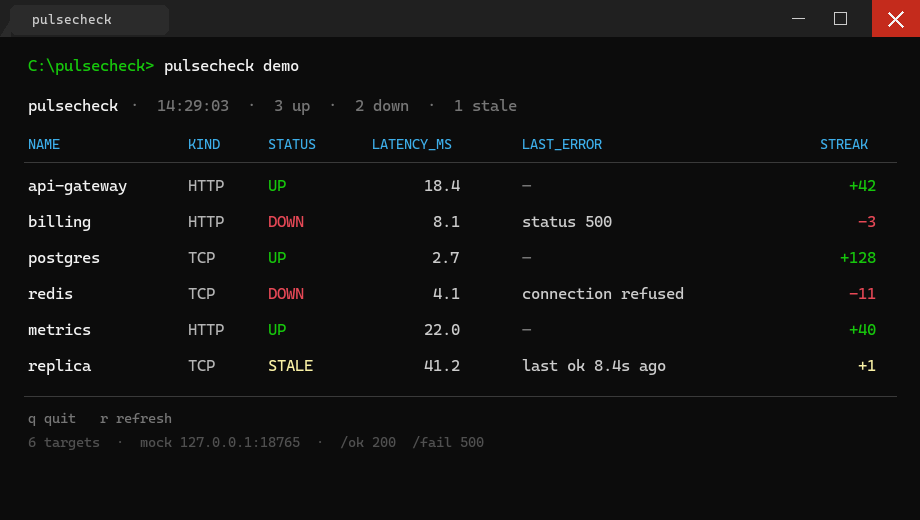

# pulsecheck

Python asyncio health probe. HTTP + TCP. Rich TUI.



## interface

Dark live table. One process, six columns, three colors.

```
┌ pulsecheck ──────────────────────────────────────────────┐
│ pulsecheck  ·  14:29:03  ·  3 up  ·  2 down  ·  1 stale  │
│                                                          │
│ NAME          KIND   STATUS   LATENCY_MS   LAST_ERROR    │
│ api-gateway   HTTP   UP       18.4         —             │
│ billing       HTTP   DOWN     8.1          status 500    │
│ postgres      TCP    UP       2.7          —             │
│ redis         TCP    DOWN     4.1          connection…   │
│ metrics       HTTP   UP       22.0         —             │
│ replica       TCP    STALE    41.2         last ok 8.4s  │
│                                                          │
│ q quit   r refresh                                       │
└──────────────────────────────────────────────────────────┘
```

| key | what it does |
|---|---|
| **q** | stop probes, leave the alternate screen |
| **r** | kick every target now (do not wait for `interval_ms`) |
| **Ctrl+C** | same as **q** |

Green **UP**, red **DOWN**, yellow **STALE** (last result older than `2 × interval_ms`, or never probed).

| you type | what it does |
|---|---|
| `pulsecheck run config.yaml` | live TUI against the file |
| `pulsecheck run config.yaml --once` | one round, print table, exit `0` if all up else `1` |
| `pulsecheck run config.yaml --once --json` | one round, one JSON object on stdout, same exit codes |
| `pulsecheck init` | write `config.yaml` in the current directory |
| `pulsecheck demo` | local aiohttp mock on `127.0.0.1:18765` (`/ok` 200, `/fail` 500), then TUI |
| `pulsecheck demo --once` | mock + one round + exit |

`samples/config.yaml` is the six-row set in the screenshot. JSON is accepted too (`samples/config.json`).

## session

```
C:\pulsecheck> python -m pulsecheck demo --once
pulsecheck  ·  14:29:03  ·  3 up  ·  3 down  ·  0 stale

NAME          KIND   STATUS   LATENCY_MS   LAST_ERROR                 STREAK
api-gateway   HTTP   UP       18.4         —                          +1
billing       HTTP   DOWN     8.1          status 500                 -1
postgres      TCP    UP       2.7          —                          +1
redis         TCP    DOWN     4.1          timeout                    -1
metrics       HTTP   UP       22.0         —                          +1
dead-http     HTTP   DOWN     301.2        timeout                    -1

C:\pulsecheck> echo %ERRORLEVEL%
1
```

`--once` exits `0` only when every row is **UP**. The live session (no `--once`) stays on screen until **q**.

## config

YAML (or JSON) root is a `targets` list. Each row is HTTP (`url`) or TCP (`host` + `port`), not both.

| field | required | meaning |
|---|---|---|
| `name` | yes | unique label in the table |
| `kind` | no | `http` or `tcp`; inferred from `url` vs `host`+`port`. Unknown kind fails load |
| `url` | HTTP | `http://` or `https://` |
| `host` / `port` | TCP | connect-only probe, then close |
| `interval_ms` | no | default `5000`; must be `> 0` |
| `timeout_ms` | no | per-target I/O budget, default `3000` |
| `retries` | no | extra attempts after a failure, default `0` |
| `backoff_ms` | no | base delay between retries, doubled each attempt, default `200` |
| `expect_status` | HTTP | omit = any `2xx` is **UP**; set = exact code only |

`--once --json` writes `{"ok": bool, "targets": [{"name", "kind", "status", "latency_ms", "error", "streak", "status_code", "endpoint"}, ...]}`. Duplicate names, empty `targets`, `interval_ms <= 0`, unknown `kind`, mixed url/host, and missing url or host+port fail load with exit `2`.

## build

```
python -m venv .venv && pip install -r requirements.txt && pytest -q && python -m pulsecheck demo --once
```
